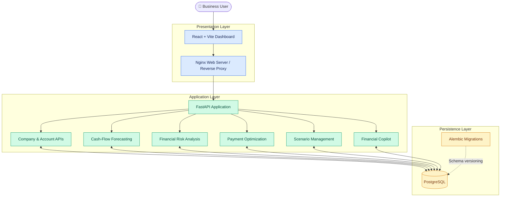
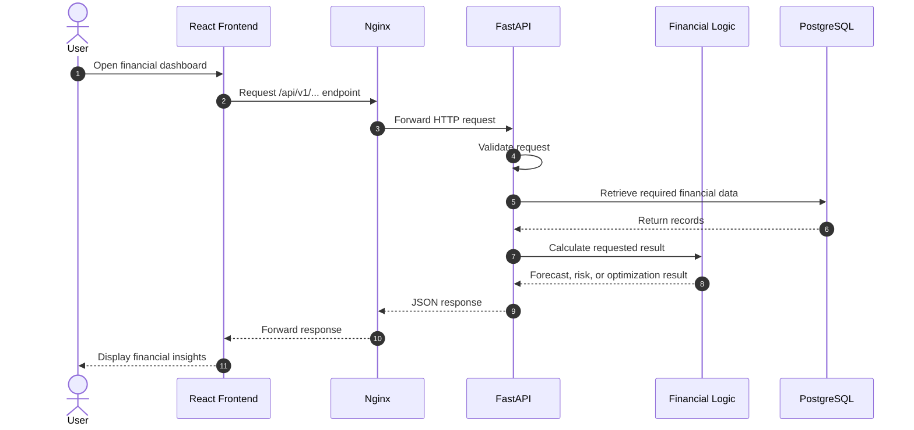
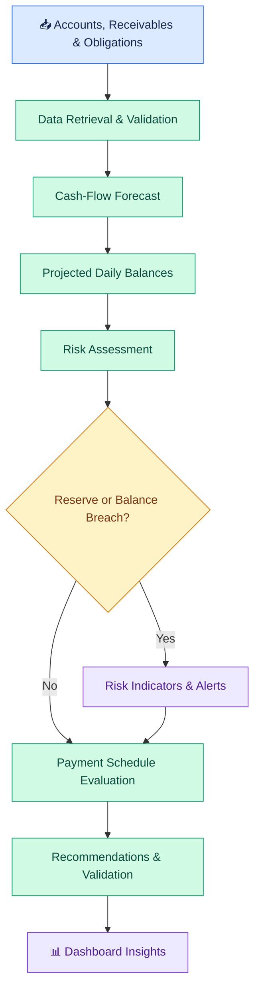

# 🏗️ FlowPilot — System Architecture

  <strong>Forecast. Optimize. Grow.</strong>
   
  Architecture, data flow, deployment, and engineering decisions behind FlowPilot.

  
  
  
  
  

---

## 1. Architecture Overview

FlowPilot is a full-stack financial intelligence platform designed to help businesses forecast cash flow, identify liquidity risks, and evaluate payment schedules.

The system separates the presentation layer, API layer, financial analysis logic, and persistence layer. This separation makes the application easier to test, maintain, and extend.

### High-level architecture

> The diagram represents the logical architecture. Individual modules may share implementation code inside the FastAPI application rather than running as separate services.

## 2. Technology Stack

| Layer | Technology | Responsibility |
|---|---|---|
| Frontend | React, Vite, JavaScript | Interactive financial dashboard |
| Web server | Nginx | Serves frontend assets and proxies API requests |
| Backend | Python, FastAPI | API endpoints and application logic |
| API server | Uvicorn | Runs the FastAPI application |
| Validation | Pydantic | Validates structured request and response data |
| ORM / database access | SQLAlchemy, Psycopg | Database access, where used by the application |
| Database | PostgreSQL | Persistent financial and application data |
| Schema migrations | Alembic | Versioned database schema changes |
| Testing | Pytest | Automated backend tests |
| Containerization | Docker | Packages application components |
| Orchestration | Kubernetes | Manages application deployments and services |
| Local cluster | Minikube | Runs Kubernetes locally |
| Cluster management | kubectl | Inspects and manages Kubernetes resources |

The table reflects the intended project stack. Check the current dependency files to confirm optional libraries and their exact usage.

## 3. Request Lifecycle

A typical request begins in the dashboard, passes through the Nginx reverse proxy, reaches FastAPI, and invokes the relevant application logic.

### Request-processing responsibilities

1. **Frontend:** Collects user input and displays results.
2. **Nginx:** Serves static files and forwards configured API paths.
3. **FastAPI:** Routes requests, validates inputs, and coordinates application operations.
4. **Financial logic:** Computes projections, checks risk conditions, or evaluates payment schedules.
5. **PostgreSQL:** Supplies persistent records required by the request.
6. **Response layer:** Returns structured results to the dashboard.

## 4. Financial Intelligence Pipeline

FlowPilot connects three primary financial workflows: forecasting, risk analysis, and payment optimization.

### 4.1 Cash-flow forecasting

The forecasting workflow estimates future account balances using available financial information.

A simplified balance equation is:

$$
B_t = B_{t-1} + I_t - O_t
$$

Where:

- \(B_t\) is the projected balance on day \(t\).
- \(B_{t-1}\) is the previous day's balance.
- \(I_t\) is the expected inflow.
- \(O_t\) is the expected outflow.

Forecast results depend on the transactions, assumptions, and time horizon supplied to the system.

### 4.2 Risk analysis

The risk-analysis workflow evaluates projected balances against relevant conditions, including minimum reserve requirements.

A simplified reserve-shortfall calculation is:

$$
S_t = \max(0, R - B_t)
$$

Where:

- \(S_t\) is the reserve shortfall.
- \(R\) is the required reserve.
- \(B_t\) is the projected balance.

This is an illustrative rule, not a complete description of every risk condition implemented in FlowPilot.

Currency balances must be evaluated consistently. Balances denominated in different currencies should not be added together without a defined conversion policy and valid exchange rates.

### 4.3 Payment optimization

The optimization workflow evaluates payment schedules against available liquidity and configured constraints.

Its current approach is heuristic-based rather than a guarantee of globally optimal results. More advanced versions can incorporate payment deadlines, penalties, supplier priorities, and additional business rules.

The output is intended to support human decisions, not automatically authorize or execute payments.

## 5. API Architecture

The backend exposes versioned REST endpoints under `/api/v1/`.

| Capability | Example endpoint | Responsibility |
|---|---|---|
| Health | `GET /health` | Application health |
| Companies | `GET /api/v1/companies` | Company information |
| Company details | `GET /api/v1/companies/{company_id}` | Individual company information |
| Accounts | `/api/v1/companies/{company_id}/accounts` | Account balances |
| Forecast | `/api/v1/companies/{company_id}/forecast` | Cash-flow projection |
| Risks | `/api/v1/companies/{company_id}/risks` | Risk analysis |
| Optimization | `/api/v1/companies/{company_id}/optimization` | Payment schedule evaluation |
| Invoices | `/api/v1/companies/{company_id}/invoices` | Receivables and invoice information |
| Obligations | `/api/v1/companies/{company_id}/obligations` | Upcoming obligations |
| Alerts | `/api/v1/companies/{company_id}/alerts` | Financial alerts |
| Scenarios | `/api/v1/scenarios` | Scenario operations |
| Copilot | `/api/v1/companies/{company_id}/
