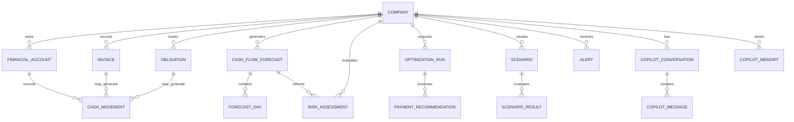
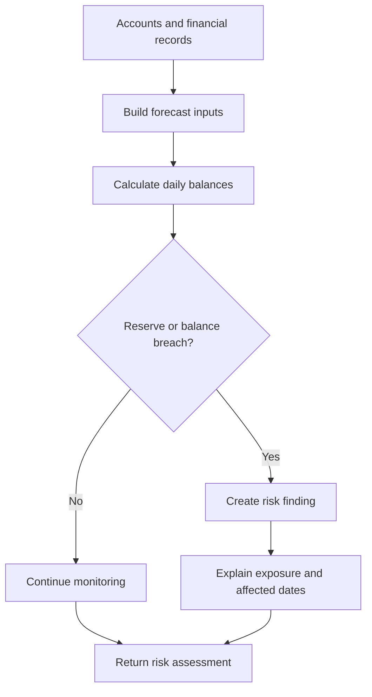
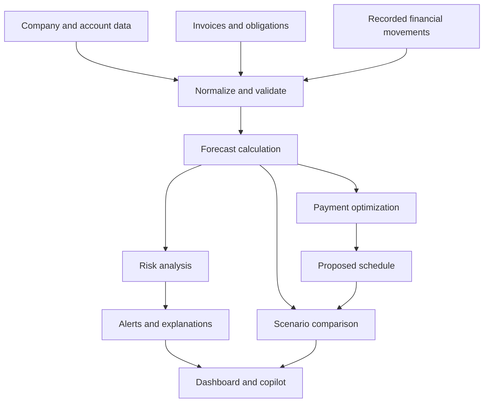

# FlowPilot — Data Model

> **Purpose:** Document how FlowPilot organizes financial data, models cash flow, evaluates financial risks, optimizes payment schedules, and supports scenario analysis.
>
> **Status:** Living documentation  
> **Database:** PostgreSQL 16  
> **Backend:** FastAPI + Python  
> **ORM and migrations:** SQLAlchemy / Alembic, where used by the current implementation  
> **Currency policy:** Balances in different currencies must remain separate unless an explicit exchange-rate conversion is implemented.

---

## 1. Overview

FlowPilot is a financial intelligence platform designed to help businesses understand their current liquidity, forecast future cash positions, identify financial risks, and evaluate alternative payment schedules.

Its data model is organized around six domains:

1. **Business and financial accounts** — companies and their cash balances.
2. **Financial transactions and commitments** — invoices, obligations, and expected cash movements.
3. **Cash-flow forecasting** — projected daily inflows, outflows, and closing balances.
4. **Risk analysis** — reserve shortfalls, negative balances, and potential liquidity problems.
5. **Optimization and scenarios** — proposed payment schedules and simulated financial outcomes.
6. **AI copilot and alerts** — conversational assistance, contextual memory, and actionable notifications.

The model separates recorded financial information from calculated predictions and proposed actions. This distinction is important because a forecast or recommendation must not be treated as an actual financial transaction.

## 2. High-Level Entity Relationship Diagram

The following diagram describes the **conceptual relationships** between FlowPilot's major data entities. It is not a verified export of the current SQLAlchemy models or PostgreSQL constraints.



**Implementation note:** Entities such as `CASH_MOVEMENT`, `FORECAST_DAY`, `PAYMENT_RECOMMENDATION`, and `SCENARIO_RESULT` describe logical concepts. They should not be interpreted as confirmed physical tables until checked against the repository's actual models and migrations.

## 3. Core Entities

### 3.1 Company

Represents a business using FlowPilot.

| Attribute | Suggested type | Description |
|---|---|---|
| `id` | Integer / UUID | Unique company identifier |
| `name` | String | Business name |
| `base_currency` | String | Preferred reporting currency |
| `created_at` | Timestamp | Record creation time |
| `updated_at` | Timestamp | Last update time |

**Responsibilities**
- Acts as the tenant boundary for financial information.
- Groups accounts, invoices, obligations, forecasts, risks, and scenarios.
- Provides the context for optimization and copilot requests.

**Integrity rules**
- Every company-owned record must reference a valid company.
- API access must verify that the requesting user is authorized to access the selected company.
- A company's reporting currency does not imply that every account balance is denominated in that currency.

### 3.2 Financial Account

Represents a cash account or other supported liquidity source belonging to a company.

| Attribute | Suggested type | Description |
|---|---|---|
| `id` | Integer / UUID | Unique account identifier |
| `company_id` | Foreign key | Owning company |
| `name` | String | Account display name |
| `currency` | String | Currency of the balance |
| `balance` | Decimal | Recorded account balance |
| `created_at` | Timestamp | Record creation time |
| `updated_at` | Timestamp | Last update time |

**Responsibilities**
- Stores the starting cash position for forecasting.
- Identifies the currency in which the balance is denominated.
- Provides the financial baseline for liquidity calculations.

**Important:** Use fixed-precision decimal types for monetary values. Avoid binary floating-point arithmetic for persisted financial amounts.

For example, USD 12,500.50 and INR 12,500.50 are different financial amounts. They must not be added together as though they were denominated in the same currency.

### 3.3 Invoice

Represents a receivable or payable document, depending on the supported invoice type.

| Attribute | Suggested type | Description |
|---|---|---|
| `id` | Integer / UUID | Invoice identifier |
| `company_id` | Foreign key | Owning company |
| `invoice_number` | String | Business-facing reference |
| `invoice_type` | Enum | Receivable or payable, if supported |
| `amount` | Decimal | Original invoice amount |
| `currency` | String | Invoice currency |
| `issue_date` | Date | Invoice issue date |
| `due_date` | Date | Expected payment date |
| `status` | Enum | Lifecycle state |
| `created_at` | Timestamp | Record creation time |

**Responsibilities**
- Supplies expected incoming or outgoing cash movements.
- Helps identify overdue receivables and upcoming payments.
- Supports forecasts and payment-priority calculations.

**Integrity rules**
- The amount must satisfy the application's validation rules.
- Currency must be explicit.
- Status transitions should be validated.
- A document should not be counted as both an actual cash movement and an expected movement for the same amount and period.

### 3.4 Obligation

Represents a planned or contractual financial outflow, such as payroll, rent, a loan repayment, or a supplier payment.

| Attribute | Suggested type | Description |
|---|---|---|
| `id` | Integer / UUID | Obligation identifier |
| `company_id` | Foreign key | Owning company |
| `name` | String | Obligation description |
| `amount` | Decimal | Amount due |
| `currency` | String | Obligation currency |
| `due_date` | Date | Scheduled due date |
| `priority` | Enum / Integer | Business-defined payment priority |
| `status` | Enum | Pending, paid, overdue, or other supported state |
| `created_at` | Timestamp | Record creation time |

**Responsibilities**
- Represents expected financial outflows.
- Supports liquidity forecasts and reserve calculations.
- Provides candidate payments for schedule optimization.

Priority should be treated as a business input, not as a guarantee that the optimizer can safely defer a payment.

## 4. Cash-Flow Forecasting Model

A forecast is a calculated projection, not a transaction ledger.

### 4.1 Forecast

A forecast represents a projection for one company over a specified horizon.

| Attribute | Suggested type | Description |
|---|---|---|
| `id` | Integer / UUID | Forecast identifier, if persisted |
| `company_id` | Foreign key | Company being forecast |
| `start_date` | Date | First forecast date |
| `end_date` | Date | Last forecast date |
| `horizon_days` | Integer | Forecast duration |
| `assumptions` | JSON / structured object | Inputs used for calculation |
| `created_at` | Timestamp | Generation time, if persisted |

The current API exposes forecast results. Whether every forecast is stored as a durable database record must be verified against the implementation.

### 4.2 Daily Forecast Entry

Each forecast day contains the projected financial movements for a specific currency.

| Attribute | Suggested type | Description |
|---|---|---|
| `date` | Date | Forecast date |
| `currency` | String | Currency for this calculation |
| `opening_balance` | Decimal | Balance at the start of the day |
| `expected_inflow` | Decimal | Expected incoming funds |
| `expected_outflow` | Decimal | Expected outgoing funds |
| `closing_balance` | Decimal | Projected end-of-day balance |
| `reserve_shortfall` | Decimal / Null | Amount below the configured reserve, if applicable |
| `below_zero` | Boolean | Whether the projected balance is negative |

### 4.3 Forecast Calculation

For each currency independently:

\[
\text{Closing Balance}_t =
\text{Opening Balance}_t +
\text{Expected Inflow}_t -
\text{Expected Outflow}_t
\]

The next day's opening balance is:

\[
\text{Opening Balance}_{t+1}
=
\text{Closing Balance}_t
\]

A reserve shortfall can be calculated as:

\[
\text{Reserve Shortfall}_t =
\max(0,\text{Minimum Reserve}-\text{Closing Balance}_t)
\]

These equations describe the intended financial logic. Exact rounding, reserve semantics, and treatment of same-day transactions must match the implemented calculation rules.

### 4.4 Double-Counting Prevention

The forecasting pipeline must distinguish between:

- Actual cash movements already reflected in the starting balance.
- Expected receipts that have not yet arrived.
- Expected payments that have not yet been executed.
- Forecast adjustments and scenario-specific changes.

A settled payment must not continue to reduce the projected balance as an outstanding obligation. Similarly, an expected receipt must not be added again if it is already included in the opening balance.

## 5. Risk Assessment Model

Risk analysis evaluates the financial implications of projected cash movements.

| Attribute | Suggested type | Description |
|---|---|---|
| `id` | Integer / UUID | Risk assessment identifier, if persisted |
| `company_id` | Foreign key | Company being assessed |
| `forecast_id` | Foreign key / Null | Forecast used for assessment |
| `risk_type` | Enum / String | Type of financial risk |
| `severity` | Enum / String | Risk severity |
| `description` | Text | Explanation of the risk |
| `affected_date` | Date / Null | Date associated with the risk |
| `currency` | String | Currency involved |
| `estimated_exposure` | Decimal / Null | Estimated financial impact |
| `created_at` | Timestamp | Assessment time |

Possible risk categories include:

- Negative projected cash balance.
- Minimum reserve breach.
- Overdue receivables.
- Concentrated payment obligations.
- Potential liquidity gaps.

The list is a conceptual taxonomy, not a claim that every category is currently implemented.

### Risk Evaluation Flow



A risk finding is an analytical result. It must not directly alter account balances or mark invoices as paid.

## 6. Payment Optimization Model

The optimization engine evaluates alternative payment schedules against financial constraints and business priorities.

### 6.1 Optimization Run

| Attribute | Suggested type | Description |
|---|---|---|
| `id` | Integer / UUID | Optimization run identifier |
| `company_id` | Foreign key | Company requesting optimization |
| `created_at` | Timestamp | Run time |
| `parameters` | JSON / structured object | Constraints and optimization inputs |
| `status` | Enum / String | Run status, if persisted |
| `result_summary` | JSON / structured object | Summary of the result, if persisted |

### 6.2 Payment Recommendation

A recommendation describes a proposed action; it is not proof that a payment was executed.

| Attribute | Suggested type | Description |
|---|---|---|
| `id` | Integer / UUID | Recommendation identifier |
| `optimization_run_id` | Foreign key | Parent optimization run |
| `obligation_id` | Foreign key / Null | Associated obligation |
| `original_due_date` | Date / Null | Original due date |
| `proposed_payment_date` | Date / Null | Suggested payment date |
| `amount` | Decimal | Amount being evaluated |
| `currency` | String | Payment currency |
| `reason` | Text | Explanation for the recommendation |
| `validation_status` | Enum / String | Constraint validation result |

### Optimization Constraints

Depending on the implemented rules, optimization may consider:

- Minimum cash reserves.
- Payment due dates and allowable deferrals.
- Payment priorities.
- Currency-specific liquidity.
- Projected daily cash balances.
- Schedule safety and breach counts.

The current optimizer should be described according to its actual implementation. A heuristic recommendation is not a guarantee of a globally optimal schedule.

**Execution boundary:** Recommendations should remain proposals until an authorized user or integrated payment system confirms execution. A recommendation must not silently update the financial ledger.

## 7. Scenario Analysis Model

Scenarios allow a user to evaluate hypothetical changes without changing the underlying financial records.

### 7.1 Scenario

| Attribute | Suggested type | Description |
|---|---|---|
| `id` | Integer / UUID | Scenario identifier |
| `company_id` | Foreign key | Owning company |
| `name` | String | User-defined scenario name |
| `description` | Text / Null | Scenario purpose |
| `parameters` | JSON / structured object | Hypothetical changes and assumptions |
| `created_at` | Timestamp | Creation time |
| `updated_at` | Timestamp | Last modification time |

### 7.2 Scenario Result

A scenario result contains the computed consequences of applying hypothetical inputs.

| Attribute | Suggested type | Description |
|---|---|---|
| `scenario_id` | Foreign key | Parent scenario |
| `calculated_at` | Timestamp | Calculation time |
| `assumptions` | JSON / structured object | Inputs used |
| `forecast_summary` | JSON / structured object | Resulting cash-flow summary |
| `risk_summary` | JSON / structured object | Resulting risk summary |
| `validation_summary` | JSON / structured object | Constraint-checking outcome |

These fields describe a suggested persistence model. The current implementation may calculate some scenario results on demand instead of storing them.

### Scenario Workflow


Scenario execution must be isolated from actual financial state. Testing a delayed payment, a late customer receipt, or an unexpected expense must not modify real invoices, obligations, or account balances.

## 8. Alerts

Alerts surface financial events that require attention.

| Attribute | Suggested type | Description |
|---|---|---|
| `id` | Integer / UUID | Alert identifier |
| `company_id` | Foreign key | Related company |
| `alert_type` | String / Enum | Alert category |
| `severity` | String / Enum | Urgency |
| `title` | String | Short alert heading |
| `message` | Text | Explanation |
| `related_entity_type` | String / Null | Associated entity type |
| `related_entity_id` | Integer / UUID / Null | Associated record identifier |
| `created_at` | Timestamp | Alert generation time |
| `is_read` | Boolean | Read state, if supported |
| `resolved_at` | Timestamp / Null | Resolution time, if supported |

Examples include an approaching reserve breach or an overdue receivable.

Alert generation should be idempotent where practical. Repeated evaluation of the same unchanged condition should not create an uncontrolled number of duplicate alerts.

## 9. AI Copilot Data Model

The copilot can help users understand financial information, explore scenarios, and interpret analytical results. Its data model must keep conversation context separate from authoritative financial records.

### 9.1 Copilot Conversation

| Attribute | Suggested type | Description |
|---|---|---|
| `id` | Integer / UUID | Conversation identifier |
| `company_id` | Foreign key | Company context |
| `title` | String / Null | Conversation title |
| `created_at` | Timestamp | Creation time |
| `updated_at` | Timestamp | Last activity time |

### 9.2 Copilot Message

| Attribute | Suggested type | Description |
|---|---|---|
| `id` | Integer / UUID | Message identifier |
| `conversation_id` | Foreign key | Parent conversation |
| `role` | Enum | User, assistant, or supported tool role |
| `content` | Text / JSON | Message content |
| `created_at` | Timestamp | Message time |
| `metadata` | JSON / Null | Optional structured metadata |

### 9.3 Copilot Memory

| Attribute | Suggested type | Description |
|---|---|---|
| `id` | Integer / UUID | Memory identifier |
| `company_id` | Foreign key | Owning company context |
| `memory_type` | String / Enum | Memory category |
| `content` | Text / JSON | Stored contextual information |
| `created_at` | Timestamp | Creation time |
| `updated_at` | Timestamp | Last update time |

These are conceptual fields; actual message and memory formats must follow the implemented models and API contracts.

**Financial integrity rules**
- Copilot messages are not authoritative financial records.
- Model-generated claims should be grounded in retrieved company data when presented as facts.
- Tool actions that change data must be validated and authorized separately.
- Memory must not bypass company-level access controls.
- Sensitive financial information should not be stored in long-term memory unless necessary and permitted.

## 10. Data Types and Integrity Rules

### Monetary Values

Use PostgreSQL `NUMERIC` / SQLAlchemy `Numeric` or an equivalent fixed-precision representation for stored financial amounts.

Example conceptual type:

```sql
amount NUMERIC(20, 4) NOT NULL
```

The precision and scale above are illustrative. Select values based on the currencies, business rules, and precision requirements supported by the implementation.

### Dates and Timestamps

- Use `DATE` for due dates and forecast calendar dates.
- Use timezone-aware timestamps for events that represent an instant in time.
- Use a consistent policy for interpreting business-local dates.
- Store enough metadata to explain when a forecast or optimization result was calculated.

### Currency

- Store currency codes explicitly.
- Keep currency-specific balances and projections separate by default.
- Do not aggregate unlike currencies without an explicit exchange rate, conversion timestamp, and conversion policy.
- Define rounding rules for converted amounts if currency conversion is added.

### Referential Integrity

Where corresponding physical tables exist, enforce appropriate foreign keys and deletion rules. Prefer explicit lifecycle transitions over deleting financial records that are needed for auditability.

### Validation

Validate at both API and persistence boundaries:

- Required fields and supported enum values.
- Positive or non-negative amounts where the domain requires them.
- Valid dates and forecast horizons.
- Company ownership of related entities.
- Consistency between currency and amount.
- Valid payment schedule constraints.
- Allowed status transitions.

## 11. Data Lifecycle



The lifecycle separates data ingestion, calculations, recommendations, and user-facing explanations. A change to the financial source data may require a new forecast and updated risk analysis.

## 12. API-to-Data Mapping

The following table maps the documented API surface to the conceptual data model. Exact request fields and response shapes should be verified against the live FastAPI OpenAPI specification.

| API resource | Main data concepts | Purpose |
|---|---|---|
| `/api/v1/companies` | Company | List or access companies |
| `/api/v1/companies/{company_id}` | Company | Retrieve company information |
| `/api/v1/companies/{company_id}/accounts` | Financial account | Retrieve account balances |
| `/api/v1/companies/{company_id}/forecast` | Forecast, daily forecast entries | Generate cash-flow projections |
| `/api/v1/companies/{company_id}/risks` | Risk assessment | Evaluate liquidity risks |
| `/api/v1/companies/{company_id}/optimization` | Optimization run, recommendations | Evaluate payment schedules |
| `/api/v1/companies/{company_id}/optimization/history` | Optimization history | Review prior runs, if supported |
| `/api/v1/companies/{company_id}/scenarios` | Scenario | Manage saved scenarios |
| `/api/v1/companies/{company_id}/scenarios/preview` | Scenario inputs and results | Evaluate hypothetical changes |
| `/api/v1/companies/{company_id}/simulation` | Simulation inputs and results | Evaluate uncertain outcomes |
| `/api/v1/companies/{company_id}/invoices` | Invoice | Access invoice records |
| `/api/v1/companies/{company_id}/obligations` | Obligation | Access payment commitments |
| `/api/v1/companies/{company_id}/alerts` | Alert | Retrieve financial alerts |
| `/api/v1/companies/{company_id}/alerts/generate` | Alert, risk findings | Generate alerts |
| `/api/v1/copilot/chat` | Conversation, message | Submit a copilot request |
| `/api/v1/copilot/chat/stream` | Conversation, message | Stream a copilot response |
| `/api/v1/copilot/conversations` | Conversation | Access conversations |
| `/api/v1/copilot/conversations/{conversation_id}/messages` | Message | Access conversation messages |
| `/api/v1/copilot/memories` | Copilot memory | Access supported memory records |
| `/api/v1/copilot/memories/{memory_id}` | Copilot memory | Access or manage a specific memory |

The mapping above reflects the known API route structure, not a guarantee that every resource is persisted as a separate table. Check `/docs` or `/openapi.json` for the actual endpoint contracts.

## 13. Security and Multi-Tenancy

Financial data must be isolated by company and authorized user.

Recommended controls:

- Validate access to the company associated with every request.
- Enforce authorization on related records, not just the parent endpoint.
- Avoid trusting a client-provided `company_id` without checking permissions.
- Keep database credentials and API secrets outside source control.
- Avoid exposing full account data or sensitive financial details in logs.
- Use explicit authorization before performing any external payment action.
- Apply retention and deletion policies to copilot messages and memories.
- Audit sensitive changes and administrative actions.

A company identifier is a data relationship, not an authorization mechanism by itself.

## 14. Performance and Scalability

Potential improvements as data volume grows include:

- Indexing foreign keys and commonly filtered fields such as `company_id`, `due_date`, `status`, and forecast dates.
- Paginating invoice, obligation, alert, and conversation endpoints.
- Caching expensive forecasts only when cache invalidation is reliable.
- Recording the input version or calculation timestamp for reproducibility.
- Moving long-running simulations to a background job system if needed.
- Partitioning high-volume event or transaction tables only when measurements justify it.
- Maintaining separate operational records and analytical snapshots when workload requirements demand it.

These are future design options, not claims about the current production deployment.

## 15. Recommended Testing Strategy

The data model should be tested through:

1. **Schema tests** — required fields, types, constraints, and migrations.
2. **Relationship tests** — company ownership and valid references.
3. **Financial arithmetic tests** — balance calculations, decimal precision, and reserve shortfalls.
4. **Currency tests** — ensure balances in different currencies are not incorrectly combined.
5. **Lifecycle tests** — settled receipts and payments are not double-counted.
6. **Forecast tests** — opening and closing balance continuity across dates.
7. **Risk tests** — critical balances, reserve warnings, and healthy scenarios.
8. **Optimization tests** — recommendations respect supported constraints and identify unsafe schedules.
9. **Scenario isolation tests** — hypothetical changes do not modify source financial records.
10. **Authorization tests** — one company cannot access another company's data without permission.
11. **Migration tests** — schema upgrades preserve existing financial data.
12. **Copilot tests** — tool outputs and generated explanations respect company context and permissions.

## 16. Current Model vs. Future Extensions

| Capability | Data-model treatment |
|---|---|
| Company and account data | Core domain entities |
| Invoices and obligations | Core financial inputs |
| Forecasting and risk analysis | Calculated financial outputs |
| Payment optimization | Proposed schedule and validation result |
| Saved scenarios | Persistent hypothetical inputs, subject to implementation |
| Alerts | User-facing risk notifications |
| Copilot conversations and memory | Separate contextual data domain |
| Payment execution and reconciliation | Future integration unless explicitly implemented |
| Exchange-rate conversion | Requires explicit rates and conversion policy |
| Full audit/event ledger | Potential future extension |
| Multi-user roles and permissions | Must match the implemented authorization model |

## 17. Keeping This Document Accurate

Update `DATA_MODEL.md` whenever the physical schema or API contracts change.

Before describing a field or entity as implemented:

1. Inspect the SQLAlchemy model definitions.
2. Inspect the Alembic migration history.
3. Compare the schema with the active PostgreSQL database.
4. Verify the corresponding API request and response models.
5. Add or update relationship and integrity tests.
6. Update the diagrams and tables in this document.

**Source of truth:** The actual model definitions, migrations, database schema, and validated API contracts take precedence over this conceptual document.

---

*FlowPilot — turning financial data into clearer forecasts, safer payment decisions, and better cash-flow visibility.*
