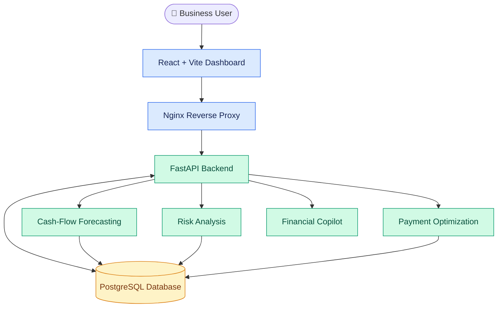
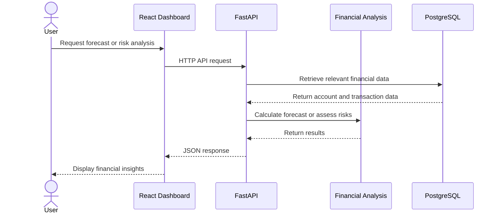
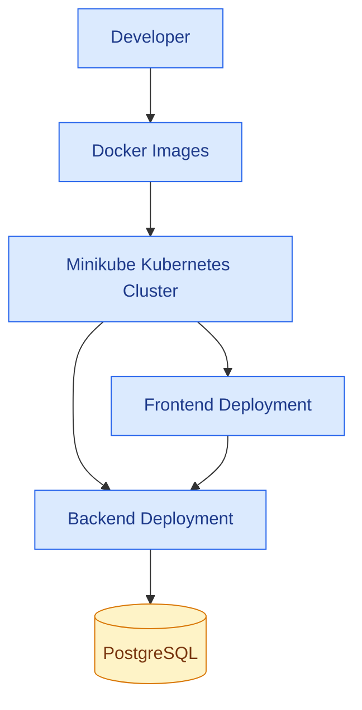
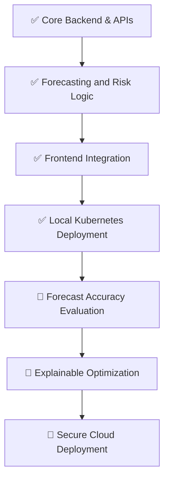

# fin_base
# 🚀 FlowPilot — Forecast. Optimize. Grow.

<p align="center">
  <strong>AI-powered cash-flow intelligence for smarter financial decisions.</strong>
  <br />
  Forecast future balances, identify financial risks, and optimize payment schedules through one unified platform.
</p>

<p align="center">
  
  
  
  
  
</p>

<p align="center">
  <a href="#-features">Features</a> •
  <a href="#-architecture">Architecture</a> •
  <a href="#-getting-started">Getting Started</a> •
  <a href="#-api-overview">API</a> •
  <a href="#-roadmap">Roadmap</a>
</p>

---

## 💡 The Problem

A business can be profitable on paper and still run out of cash.

Delayed customer payments, upcoming supplier obligations, and poor visibility into future account balances can create unexpected liquidity problems. Traditional financial dashboards often focus on what has already happened rather than what might happen next.

**FlowPilot is designed to help businesses anticipate financial risks before they become urgent problems.**

## ✨ What Is FlowPilot?

FlowPilot is a financial intelligence platform that connects cash-flow forecasting, financial risk analysis, and payment optimization in a single workflow.

Instead of simply displaying account balances, FlowPilot helps answer three important questions:

- 🔮 **What might my cash position look like in the future?**
- 🛡️ **When could my business face a cash shortage or reserve breach?**
- ⚙️ **How can I evaluate payment schedules against available liquidity?**

The goal is to make financial planning more proactive, transparent, and actionable.

## 🎯 Features

<table>
  <tr>
    <td width="50%">
      <h3>🔮 Cash-Flow Forecasting</h3>
      Project future balances using expected inflows, outflows, receivables, and obligations.
    </td>
    <td width="50%">
      <h3>🛡️ Financial Risk Analysis</h3>
      Identify potential cash shortages and reserve shortfalls that require attention.
    </td>
  </tr>
  <tr>
    <td width="50%">
      <h3>⚙️ Payment Optimization</h3>
      Evaluate payment schedules using a deterministic, heuristic-based approach.
    </td>
    <td width="50%">
      <h3>📊 Financial Dashboard</h3>
      Explore company information, accounts, forecasts, invoices, obligations, and alerts.
    </td>
  </tr>
  <tr>
    <td width="50%">
      <h3>🤖 Financial Copilot</h3>
      A conversational interface for exploring financial information and potential actions.
    </td>
    <td width="50%">
      <h3>🧪 Scenario Analysis</h3>
      API support for evaluating scenarios and exploring alternative financial outcomes.
    </td>
  </tr>
</table>

> **Note:** Recommendations are decision-support outputs, not guaranteed financial outcomes. Forecast accuracy depends on the quality of available data and assumptions.

## 🏗️ Architecture

FlowPilot uses a frontend, backend API, and PostgreSQL database. The frontend communicates with the backend through an Nginx reverse proxy. The application can be containerized with Docker and deployed locally using Kubernetes.



### Request lifecycle



## 🧠 How FlowPilot Works


1. **Collect:** Retrieve relevant account information, expected receivables, and obligations.
2. **Prepare:** Organize financial data for analysis.
3. **Forecast:** Estimate future account balances over a selected horizon.
4. **Assess:** Check projected balances against risk and reserve conditions.
5. **Optimize:** Evaluate payment schedules using the available constraints and assumptions.
6. **Present:** Return the results through API responses and the dashboard.

## 🛠️ Technology Stack

| Layer | Technologies | Purpose |
|---|---|---|
| Frontend | React, Vite, JavaScript, CSS | Dashboard and user interactions |
| Backend | Python, FastAPI, Uvicorn | API endpoints and application logic |
| Data validation | Pydantic | Request and response validation |
| Database | PostgreSQL | Persistent financial data |
| Database migrations | Alembic | Schema versioning and migrations |
| Database connectivity | SQLAlchemy, Psycopg | Python-to-PostgreSQL integration |
| HTTP communication | Axios | Frontend API requests |
| Web server | Nginx | Static assets and reverse proxy |
| Containerization | Docker | Container images |
| Orchestration | Kubernetes, Minikube, kubectl | Local deployment and management |
| Testing | Pytest | Automated backend tests |

*This list reflects the project stack discussed during development. Verify each dependency against your current repository before treating the table as a complete dependency inventory.*

## 📂 Project Structure

The following is a logical overview of the application. Adjust directory names to match the exact contents of your repository.

```text
FlowPilot/
├── Backend/
│   ├── app/
│   │   ├── api/
│   │   ├── models/
│   │   ├── schemas/
│   │   ├── services/
│   │   └── main.py
│   ├── alembic/
│   ├── tests/
│   ├── requirements.txt
│   └── Dockerfile
├── Frontend/
│   ├── src/
│   ├── public/
│   ├── package.json
│   └── Dockerfile
├── docker-compose.yml
├── k8s/
└── README.md
```

> The tree is illustrative, not a verified file listing. Your repository may use different directory names or organize its frontend and backend differently.

## 🚀 Getting Started

### Prerequisites

Install the following tools:

- Python and pip
- Node.js and npm
- PostgreSQL
- Docker Desktop
- Git

For Kubernetes deployment, also install:

- kubectl
- Minikube

### 1. Clone the repository

```bash
git clone https://github.com/Soumadipdutta/fin_base.git
cd fin_base
```

### 2. Configure the backend

Open the backend directory and create a virtual environment.

```powershell
cd Backend

python -m venv env
.\env\Scripts\Activate.ps1

python -m pip install -r requirements.txt
```

Configure the database connection using the environment variable expected by your backend. For example:

```text
DATABASE_URL=postgresql+psycopg://<username>:<password>@<host>:<port>/<database>
```

Replace the placeholders with your own local development settings. Do not commit database passwords or API keys.

### 3. Start the backend

From the backend directory:

```powershell
python -m uvicorn app.main:app --reload --port 8000
```

Open the API documentation:

- Swagger UI: [http://localhost:8000/docs](http://localhost:8000/docs)
- Health endpoint: [http://localhost:8000/health](http://localhost:8000/health)

If port `8000` is already occupied, use a different port and update your frontend configuration accordingly.

### 4. Start the frontend

In a separate terminal, navigate to your frontend directory and install its dependencies.

```powershell
npm install
npm run dev
```

Use the local URL printed by Vite. Make sure the frontend API configuration points to your running backend, preferably through the configured development proxy.

### 5. Run tests

From the backend directory, with the virtual environment activated:

```powershell
python -m pytest -v
```

Tests should pass before you consider a build ready for demonstration.

## 🔌 API Overview

FlowPilot exposes API routes for its core financial workflows.

| Capability | Example route | Purpose |
|---|---|---|
| Health | `GET /health` | Check API availability |
| Companies | `GET /api/v1/companies` | Retrieve company information |
| Accounts | `GET /api/v1/companies/{company_id}/accounts` | Retrieve company accounts |
| Forecasting | `GET /api/v1/companies/{company_id}/forecast?days=30` | Generate a cash-flow forecast |
| Risk analysis | `GET /api/v1/companies/{company_id}/risks` | Retrieve financial risk analysis |
| Optimization | `POST /api/v1/companies/{company_id}/optimization?days=30` | Evaluate a payment schedule |
| Invoices | `/api/v1/companies/{company_id}/invoices` | Access invoice information |
| Obligations | `/api/v1/companies/{company_id}/obligations` | Access payment obligations |
| Alerts | `/api/v1/companies/{company_id}/alerts` | Retrieve financial alerts |
| Scenarios | `/api/v1/scenarios` | Work with financial scenarios |

Check the live OpenAPI specification at `/openapi.json` or Swagger UI at `/docs` to confirm each route and its HTTP method for your current build.

### Example: Retrieve a forecast

```bash
curl "http://localhost:8000/api/v1/companies/4/forecast?days=30"
```

Example response shape:

```json
{
  "company_id": 4,
  "base_currency": "USD",
  "forecast_start": "YYYY-MM-DD",
  "forecast_end": "YYYY-MM-DD",
  "days": 30,
  "assumptions": {},
  "daily_forecast": []
}
```

The example illustrates the response structure; actual dates, assumptions, and forecast values depend on your database and implementation.

## 🐳 Docker & Kubernetes

FlowPilot can be containerized and deployed locally using Docker and Kubernetes.



Useful commands for inspecting a Kubernetes deployment:

```bash
kubectl get nodes
kubectl get deployments -n flowpilot
kubectl get pods -n flowpilot
kubectl get services -n flowpilot
```

View backend logs:

```bash
kubectl logs deployment/flowpilot-backend -n flowpilot
```

For a local demonstration, the frontend and backend can be exposed using Kubernetes port-forwarding, depending on your service configuration.

**Security note:** Keep secrets out of Git, restrict access to financial data, and do not expose a development database or an unauthenticated API publicly.

## 📈 Development Roadmap



The roadmap distinguishes core capabilities already developed from planned improvements. The completed items refer to the current development work and do not imply production readiness.

| Priority | Planned improvement |
|---|---|
| High | Improve forecast accuracy measurement |
| High | Add stronger validation for financial inputs |
| High | Strengthen authentication and authorization |
| Medium | Improve payment priorities and constraint handling |
| Medium | Add explicit currency conversion support |
| Medium | Improve scenario comparison and explanations |
| Future | Add cloud deployment, monitoring, and operational alerts |

## ⚠️ Current Limitations

FlowPilot is an evolving project. Some limitations to address include:

- Forecast quality depends on the completeness and reliability of financial data.
- Currency balances should remain separate unless a valid conversion mechanism is available.
- The current optimization approach is heuristic-based and may not model every supplier penalty or business constraint.
- Recommendations should be validated against real-world financial policies before being used for consequential decisions.
- Production deployment requires appropriate access controls, secret management, monitoring, and security testing.

## 🤝 Contributing

Contributions, bug reports, and suggestions are welcome.

1. Fork the repository.
2. Create a feature branch.
3. Implement your change and add relevant tests.
4. Run the existing test suite.
5. Submit a pull request describing your changes.

Please avoid committing credentials, customer financial data, database dumps, or local environment files.

## 🔮 What's Next?

Our long-term vision is to make FlowPilot a more intelligent financial decision-support platform through:

- Better forecasting models and historical accuracy evaluation.
- Explainable risk detection and optimization recommendations.
- Scenario simulations for comparing financial decisions.
- Secure multi-company access and role-based permissions.
- Reliable multi-currency financial analysis.
- Cloud deployment, monitoring, and operational observability.

## 🌟 Vision

We believe businesses should have time to respond to financial risks before those risks become urgent.

FlowPilot brings together **forecasting, risk analysis, and payment optimization** to help businesses move from reactive cash management toward proactive financial planning.

<p align="center">
  <strong>FlowPilot — Forecast. Optimize. Grow.</strong>
</p>

---

<p align="center">
  Built with ☕, curiosity, and a focus on better financial decisions.
</p>
